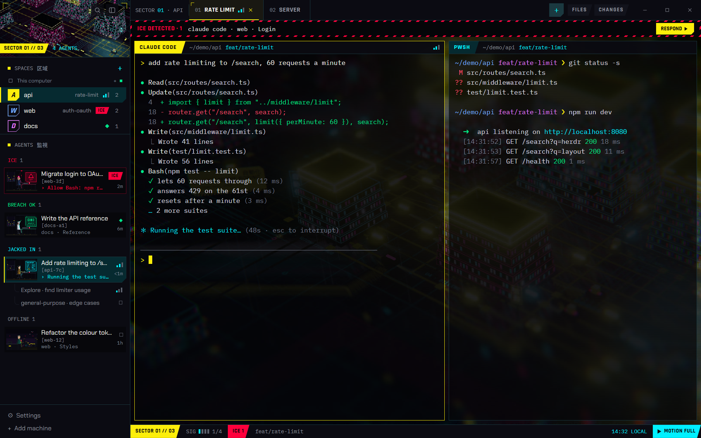

# Herdr layouts

Layouts for the [Herdr](https://herdr.dev) desktop app, one folder each.

| Layout | |
|---|---|
| [Breach Protocol](breach-protocol/) | A cyberpunk HUD: yellow, cyan and red on black, cut-corner plates, a chip city behind the terminals and netrunners as agents. Alpha. |

## Install

Ask your agent in Herdr:

> Read ~/.config/herdr-app/AGENTS.md, then add the layout in https://github.com/dawid-walter/herdr-layouts/tree/main/breach-protocol

Each folder's README also has a Windows installer (`install.ps1`) that backs up first and can uninstall.

## With Claude Code

If you run Claude Code in Herdr, install the matching status line too: [rghtON statusline](https://github.com/dawid-walter/rghton-statusline) with the theme `herdr` follows the layout shown in Herdr and draws Breach in this layout's colours.

## License

Code under MIT (`LICENSE`). Fonts keep their SIL Open Font License; art credits are in each layout's README.
