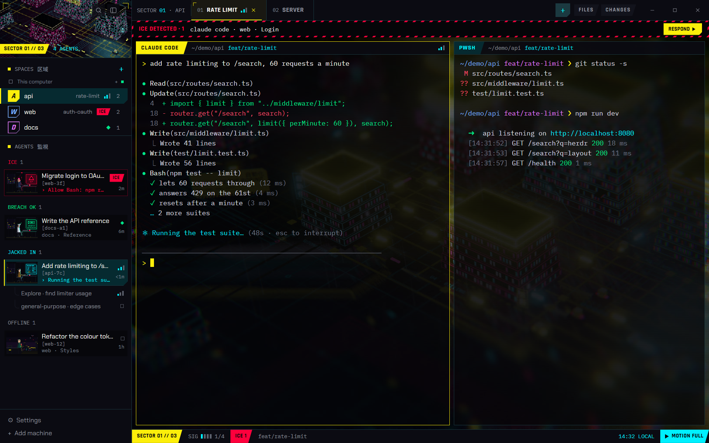
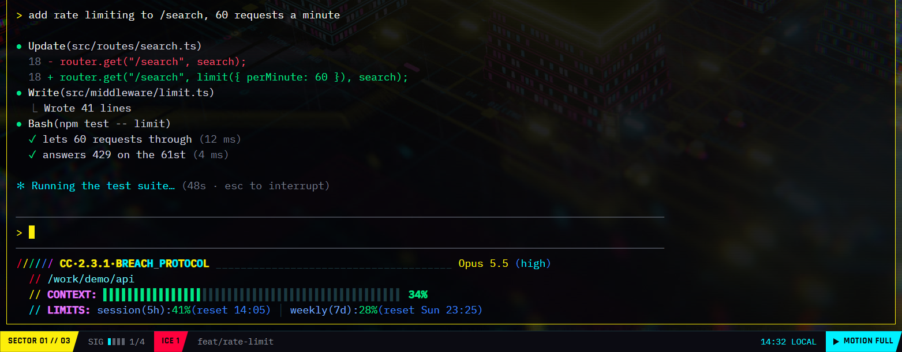

# Breach Protocol for Herdr

A cyberpunk HUD layout for the Herdr desktop app: yellow, cyan and red on black, cut-corner plates, a chip city behind the terminals and netrunners as agents.
Palette, shapes and art from the cyberpunk HUD variant of the Megagency site.



> Status: **alpha** (v0.1.0). Used day to day in Herdr 0.1.16 on Windows 11, installed with `install.ps1`.
> Not yet seen live: the ICE alarm bar and its RESPOND button with a real waiting agent, sub-agent rows, the narrow sidebar (rail) with the new cards. Not tried on macOS or Linux.
> `preview.png` and `layouts/breach-protocol.png` are drawn from a faithful mockup with neutral demo data (spaces `api`, `web`, `docs`), not a screenshot of someone's real workspace.

## Install

The same way as anything from herdr.dev/gallery: ask your agent

> Read ~/.config/herdr-app/AGENTS.md, then add the layout in this folder.

**Also copy `themes/breach-protocol.json` into the Herdr home's `themes/`.** The gallery steps copy only `layouts/` and `mods/`; without the theme the layout falls back to Herdr's default colours.
Then merge `keys.json` into yours (two keys: Motion, and Ctrl+Shift+K for the layout's Go to window) and switch with `herdr-app do layout.switch --name breach-protocol`.

Or on Windows, by hand:

```powershell
powershell -ExecutionPolicy Bypass -File .\install.ps1 -DryRun   # what would happen
powershell -ExecutionPolicy Bypass -File .\install.ps1            # back up, then copy
powershell -ExecutionPolicy Bypass -File .\install.ps1 -Uninstall # remove exactly what it installed, files and keys
```

`-ExecutionPolicy Bypass` applies only to this one run and changes no system setting. In PowerShell 7 (`pwsh`) plain `.\install.ps1` works.

The installer adds two keys to `keys.json`, both for this layout only. Note that any edit makes that file yours, so Herdr stops adding new default shortcuts to it on upgrade; run `powershell -ExecutionPolicy Bypass -File .\install.ps1 -NoKeys` to leave it alone and add the keys by hand.

Switch layouts with Ctrl+Shift+L. Your `main` layout stays as it was.

> **Sounds.** Herdr plays its own alert sounds; the layout adds none, so nothing plays twice. To hear this layout's
> sounds instead, set this in `settings.json` (Herdr home). It applies to every layout, and "enabled": false still means silence.
> Remove the two paths before you uninstall.
>
> ```json
> "sounds": { "enabled": true, "done": "mods/breach-protocol-ui/sounds/ok.mp3", "blocked": "mods/breach-protocol-ui/sounds/ice.mp3" }
> ```

## Motion

Two modes, chosen with the button in the bottom-right corner of the status bar (it shows a play mark while it moves, a pause mark while it stands still) or with Ctrl+Shift+. :

- **FULL:** the chip city loops in the sidebar header, the netrunner scenes play, a card jolts for 0.3 s when its agent changes state.
- **MIN:** everything stands still. Only working agents keep their signal bars climbing, one step a second, on their card, their tab and their space, so you always see what works where. ICE is a steady red; done and idle are still.

The choice is kept in the shared key `motion` (`"full"` / `"min"`), so it carries over to the Replicant layout.
Herdr does not tell mods about the system's "reduce motion" setting, so MIN is the way to calm it down.

## Clock

The status bar shows the time as 24-hour `HH:MM`. For a 12-hour clock (`9:05 PM`), give the status block a prop in `layouts/breach-protocol.json`:

```json
{ "id": "status", "type": "block", "size": { "px": 28 }, "content": { "mod": "breach-protocol-status", "props": { "clock": "12h" } } }
```

Edit the copy in the Herdr home (`~/.config/herdr-app/layouts/`) and it applies at once; edit the package's copy too, or the next install puts 24-hour back.

## Claude Code status line

Recommended if you run Claude Code in Herdr: the [rghtON statusline](https://github.com/dawid-walter/rghton-statusline) has a Breach look, a cyberpunk HUD with a glitching sign in this layout's colours.
Install it with the theme `herdr` (`.\install.ps1 -Theme herdr` on Windows, `./install.sh --theme herdr` on Linux and macOS) and it follows the layout shown in Herdr, reading the colours from `themes/breach-protocol.json`.
Its installer changes only the `statusLine` entry in `~/.claude/settings.json` and backs the file up first.



## Session names on agent cards (optional)

Each agent card can show the Claude Code session's name in brackets (`[api-7c]`) under its title. Neither Herdr nor Claude Code puts that name where the layout can see it, so `extras/herdr-session-label.sh`, a small Claude Code hook, does: when a session starts and on each prompt it runs `hc label <terminal> claude=<name>` for the Herdr terminal the session is in. Without it the cards simply leave that line out.

1. Copy `extras/herdr-session-label.sh` to `~/.claude/hooks/`. It needs `jq`.
2. Add the hook to `~/.claude/settings.json`, next to any hooks you already have:

```json
"hooks": {
  "SessionStart":     [{ "hooks": [{ "type": "command", "command": "bash ~/.claude/hooks/herdr-session-label.sh", "timeout": 10 }] }],
  "UserPromptSubmit": [{ "hooks": [{ "type": "command", "command": "bash ~/.claude/hooks/herdr-session-label.sh", "timeout": 10 }] }]
}
```

On Windows, if `bash` is not found, give Git Bash and the script by full path: `"\"C:/Program Files/Git/bin/bash.exe\" C:/Users/<you>/.claude/hooks/herdr-session-label.sh"`.
New sessions get their name from then on; review or turn the hook off in Claude Code's `/hooks`. Outside Herdr it does nothing.

## What it reaches

- No network.
- `breach-protocol-spaces` runs `git` in your spaces' folders and `hc machine ls`, as Herdr's own spaces list does (branch and ahead/behind, machines).
- It reads nothing outside the Herdr home and your spaces' folders.
- The optional `extras/herdr-session-label.sh` hook (only if you add it) reads `~/.claude/sessions/` and runs `hc label` on the terminal its own session is in.

## Credits

- Fonts: Rajdhani (Indian Type Foundry), Chakra Petch (Cadson Demak) and IBM Plex Mono (IBM), SIL Open Font License, see `mods/breach-protocol-ui/fonts/` (`LICENSE-Rajdhani.txt`, `LICENSE-ChakraPetch.txt`, `LICENSE-IBMPlexMono.txt`).
- Background and sidebar city: rendered from the Megagency site's own WebGL hero scene (megagency.pl), used with permission.
- Netrunner scenes: pixel art drawn in code for this layout (6 characters × 4 states).
- Sounds: synthesised for this layout.
- Behaviour of tabs, pane headers, spaces, agents, toasts and the Go to window: clones of Herdr 0.1.16's shipped mods.

## License

The code (layout, theme, mods, installer, recipe) is MIT, see `LICENSE`. The fonts keep their SIL Open Font License (files in `mods/breach-protocol-ui/fonts/`). The city art is the Megagency site's, used with permission; ask before reusing it outside this layout.
