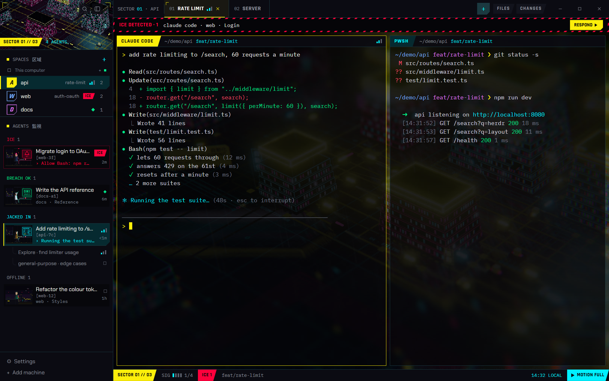

# Breach Protocol

A cyberpunk HUD for Herdr. Near-black panels with cut corners over a dimmed chip city that shows through the terminals; yellow means "you are here", cyan "working", red "needs you" (ICE) and green "done". Agents are netrunners at their desks: jacked in while they work, a red ICE screen when they need you, `[OK]` when they finish, and sitting on a rooftop when idle. A striped ICE alarm lists every agent that waits for you, and a MOTION switch stills everything except the signal bars of working agents.

## What you see

Left to right, top to bottom, at zoom 1:

- **Sidebar, 268 px, `chrome` #0b0b12.**
  - **Header, 118 px:** a looping chip-city scene (270 × 119 GIF, 66 frames at 15 fps; its last 1.6 s crossfade into its first, so the loop has no seam), yellow corner ticks (12 px, 1.5 px lines) top left and top right, search and sidebar buttons top right (26 px squares on `chrome` at 80%), and at the bottom left a yellow skewed plate `SECTOR 01 // 05` (shown space // number of spaces, Rajdhani Bold 11, black text) with `N AGENTS` in cyan IBM Plex Mono 10.5.
  - **Spaces:** header `■ SPACES 区域` (6 px yellow square, IBM Plex Mono 10.5, muted). Rows of 32 px: a 24 × 24 token with its bottom-right corner cut by 7 px, outlined in the space's colour on `chrome`, the space's first letter in Rajdhani Bold Italic 15 in that colour; the status notch (7 px triangle) in the cut corner: red ICE, green done, cyan working. Then the name (Chakra Petch 13), the git tail (repo · branch ↑ahead ↓behind), then the same marks as the tabs: climbing signal bars while an agent works there, a red ICE chip while one waits, a green rhombus when one is done (bars and a mark can show together: Herdr gives a space or tab only its most urgent status, blocked > done > working, so the bars also look at the tabs' `working_since`); and the tab count (mono 11). A machine's link light is a 5 px square (green: connected, dim: not), never a dot, so it doesn't read as a status. The shown space: `selected` #062a30 background, a 2 px yellow left edge, an 8 px cut corner, a yellow token with black letter.
  - **Agents:** header `■ AGENTS 監視`. Sections ICE (red), BREACH OK (green), JACKED IN (cyan), OFFLINE (muted). Each agent is a slim card, about 62 px: a 64 × 44 netrunner scene; the session's title (the terminal title the agent sets; Chakra Petch 13); Claude Code's session name from its terminal label `claude` in brackets (`[herdr-theme-0d]`, mono 10, muted); the three lines sit tight (16 / 13 / 14 px line heights); under it, while it works or waits, what it is doing (its report, `› …` mono 10.5, cyan or red), otherwise `space · tab` (dim); on the right the status mark (bars, ICE chip, green rhombus, idle square) over the time since the state changed, or on hover the pin. Sub-agents: 22 px rows with tree lines, two shown (most urgent first) and `+N more`. The focused agent's card: `selected` background, yellow 2 px left edge, 9 px cut corner; an ICE card has a red border. Grouped by space, each group's header is drawn like that space's row in the spaces list (24 px token in the space's colour, the name as written, the agent count on the right).
  - **Footer, 69 px:** Herdr's shipped workspace-chrome footer (Settings, Add machine).
- **Tab bar, 42 px.** `SECTOR 01 · FIRMA-WWW` (mono 11; number cyan), then flat tabs separated by 1 px `border` lines: `01` (mono 10.5, dim) and the name (Rajdhani Bold 13.5, upper case). The active tab: a 2 px yellow underline, a 6 px yellow corner tick top left, yellow ✕. Status on a tab: climbing bars (working), a red `ICE` chip plus red notch top right (blocked), a green rhombus plus green notch (done). Right: `+` on a 30 × 28 plate with a 7 px cut, `FILES` and `CHANGES` skewed plates (cyan when open), and the window buttons (46 px; close turns red on hover).
- **ICE alarm, 34 px, only while an agent waits.** Red and black diagonal hazard stripes with a 3 px border, inside on `background`: `ICE DETECTED · N` (Rajdhani Bold 13, red), the waiting agents as `program · space · tab` joined by `//` (mono 12), and a yellow `RESPOND ▶` plate (96 × 24, 6 px cut).
- **Panes.** The dimmed hero scene is the window background; panes have no fill, sharp corners, a 1 px `border` frame and a yellow 1 px frame when focused; `terminal_opacity` 0.45. Each pane's 26 px header: a skewed plate with the program's name (yellow with black text when focused, teal `selected` with cyan text otherwise), the folder (mono 11, muted), the branch (cyan), the status (bars, ICE chip, green rhombus), and on hover split right, split down, zoom, close.
- **Status bar, 28 px.** A yellow `SECTOR 01 // 05` plate, `SIG` with one drawn cell per agent, lit cyan while it works, and `1/4`, a red `ICE 1` plate while someone waits, the machine and branch, then right-aligned the clock `21:47 LOCAL` (cyan, 24-hour; `"clock": "12h"` in the block's props for 9:47 PM), and the `▶ MOTION FULL` / `❚❚ MOTION MIN` plate in the bottom-right corner (the play or pause mark is drawn inside the plate).
- **Toasts, 340 × 72** inside Herdr's own frame: `BREACH SEQUENCE ●` (needs you) or `BREACH OK ✓` (done), the agent's title and body, and `RESPOND ▶` / `OPEN ▶` and `LATER` plates.

Colours (all from `themes/breach-protocol.json`): background #050508, chrome #0b0b12, raised #12131c, selected #062a30, border #1b3940, accent #fcee0a, working/ring #00f0ff, blocked #ff003c, done #00e68a, idle #5b606c, foreground #f3f3ee, muted #8d919c.

## How it behaves

- **Working:** cyan; signal bars climb one step a second on the card, the tab and the space row; scene: the netrunner jacked in, hex code scrolling on the holo screen.
- **Contrast (WCAG):** every chip has dark text, ICE included (black on red 5.2 : 1; white was 3.6). Unlit bar segments and SIG cells are `idle` grey (3.2 : 1), so one lit bar reads as 1 of 3. On a selected row, secondary text is `muted`, not `dim` (dim on `selected` is 4.0 : 1).
- **Blocked (ICE):** red, steady (never blinking); the ICE alarm appears with the agent listed, the status bar counts it, the tab and pane get an ICE chip; scene: a red ICE screen, a beacon sweeping, a hand to the temple; sound (via settings.json) `ice.mp3`.
- **Done (BREACH OK):** green rhombus and notch; scene: `[OK]` on the screen, the netrunner leaning back, cable unplugged; sound (via settings.json) `ok.mp3`.
- **Idle (OFFLINE):** no mark beyond a dim square; scene: sitting on a rooftop above the chip city with a can.
- Sounds: the layout plays none (Herdr plays its own alert, so nothing doubles); `ok.mp3` and `ice.mp3` are offered for `sounds.done` / `sounds.blocked` in settings.json, by hand (README, Install).
- **MOTION FULL:** the header city loops, scenes play (8 frames at 8 fps), a card jolts 3 px for 0.3 s and its title turns cyan when its state changes.
- **MOTION MIN:** the city and scenes show a still frame and nothing jolts. Signal bars of working agents keep climbing; that is the only motion left.
- **Go to** (the sidebar's search button, Ctrl+Shift+K): Herdr's tab picker in the HUD look: a yellow top edge, `GO TO 移動`, an input with a cut corner, spaces as their tokens, tabs as upper-case Rajdhani names with the layout's status marks and the session titles of their agents, the selected row with a yellow edge, the current tab marked `HERE`.
- Switch with the `MOTION` plate or Ctrl+Shift+. ; the choice is the shared key `motion`, also read by the Replicant layout.
- Clicks and keys are Herdr's own: click a card or ICE's RESPOND to focus that agent's pane, click a tab to select, drag to reorder, double-click to rename, right-click for menus, wheel over the tab bar to switch tabs, `+` for a new tab, FILES/CHANGES toggle the side panel.
- The sidebar folds to a 44 px rail (Herdr's behaviour); the header then shows only the sidebar button.

## Built from

- **Layout** `layouts/breach-protocol.json` (root row: `theme` `breach-protocol`, `toast` `breach-protocol-toast`, `preview` `layouts/breach-protocol.png`, `font` IBM Plex Mono 14, `ui_font` Chakra Petch, `background` image `mods/breach-protocol-ui/art/hero-dim.jpg` cover, `terminal_opacity` 0.45):
  - `sidebar` column 268 px: `brand` block 118 px (window drag) → `breach-protocol-brand`; `sidebar-lists` with `spaces` (weight 0.8) → `breach-protocol-spaces` and `agents` (weight 1.2) → `breach-protocol-agents`; `sidebar-footer` 69 px → shipped `workspace-chrome` `{ "footer": true }`.
  - `work` column: `tabs` 42 px (window drag) → `breach-protocol-tabs`; `ice` 34 px, `hidden: true` → `breach-protocol-status` `{ "ice": true }`; `work-body` row (padding 8, gap 8) with `main` (active tab; pane frame gap 8, radius 0, background `#00000000`, border `border`, focus `accent`, header 26 px → `breach-protocol-pane`) and the shipped `panel` stack (`files`, `changes`); `status` 28 px → `breach-protocol-status`.
- **Theme** `themes/breach-protocol.json`: named like the layout, so it is the layout's own.
- **Mods** (each carries a copy of `breach.js`, the shared look: cut polygons via `globalThis.window.paint_path` and `PathBuilder`, hazard stripes via `Background.pattern_slash`, skewed chips, rhombus, notch, signal bars, the `motion` helpers):
  - `breach-protocol-ui`: draws nothing; `fonts/` (Rajdhani, Chakra Petch, IBM Plex Mono, each with its `LICENSE-.txt`, SIL OFL), `art/` (hero-dim.jpg, city-head.gif/png, bars-working.gif (3 frames, 1 s each, 26 × 20 shown at 13 × 10), `runners/<id>-<status>.gif|png` for 6 netrunners × 4 states at 256 × 176), `sounds/` (ice.mp3, ok.mp3).
  - `breach-protocol-brand`: the sidebar header.
  - `breach-protocol-tabs`, `breach-protocol-pane`, `breach-protocol-spaces`, `breach-protocol-agents`, `breach-protocol-toast`, `breach-protocol-picker`: clones of Herdr 0.1.16's `tabs`, `pane`, `spaces`, `agents`, `toast`, `picker` with the drawing replaced. The picker opens as the popup its mod.json describes (`mod.open`).
  - `breach-protocol-status`: status bar and, with `{ "ice": true }`, the ICE alarm. The bar shows and hides the `ice` block (`layout.show` / `layout.hide`) and takes the key command `motion` through `nextCommand()`.
- **Keys** `keys.json`: `{"layout:breach-protocol": {"ctrl-shift-.": "breach-protocol-status.motion", "ctrl-shift-k": "mod.open:breach-protocol-picker"}}`.
- **herdr functions:** `spaces`, `agents`, `panes`, `terminals`, `focused`, `machines`, `layout`, `theme`, `shared`/`setShared` (`motion`, `space.colors`, `workspace.panels`, `agents.sort`), `setAgentOrder`, `run` (`pane.focus`, `tab.*`, `space.*`, `layout.show/hide/select/resize`, `window.*`, `terminal.pin`), `openOverlay`, `closeOverlay`, `exec` (git), `hc` (machine ls), `watchFolder`, `nextCommand`, `props`, `settings`, `window`, `home`.
- **Art:** the background and the header loop are frames of the Megagency site's WebGL hero scene with the page's interface hidden; the netrunners are pixel art drawn in code on a 128 × 88 grid and exported at 2×.

## Watch out

- **The theme file:** the gallery's install steps copy only `layouts/` and `mods/`. Also copy `themes/breach-protocol.json` into the Herdr home's `themes/`, or the layout shows Herdr's default colours.
- `line_height(16)` is a multiplier (16 × the font size), not pixels: write `line_height("16px")`.
- Small drawn polygons (a 7 px rhombus) come out lopsided at fractional zoom, because their half-pixel points antialias unevenly. The done rhombus is an SVG (`art/rhombus.svg`, tinted) instead.
- `terminal_opacity` applies twice (what shows is 1 − (1 − x)²): 0.45 covers about 70% of the background. 0.7 would hide it.
- Herdr always draws a toast 340 × 72 in its rounded frame; the mod only draws inside.
- A hidden block never starts its mod, so the ICE block cannot show itself: the status bar does it.
- `paint_path` points are px with no calc: cut shapes of varying width are built from a coloured body plus a fixed-size triangle (`tail`, `corner`, `notch`), not one polygon.
- Signal bars are not text: block glyphs (▂▄▆) come from different fallback fonts and don't line up at the bottom. Working bars are a 3-frame GIF with a transparent background, the others are three bottom-aligned 3 px divs.
- `space.colors` is shared with other layouts; Breach shows yellow (ansi3) as bright blue and red (ansi1) as bright magenta, because yellow and red mean "here" and ICE.
- The kanji 区域 and 監視 rely on a system font that has them (Windows and macOS do); elsewhere they may show as boxes.
- Herdr gives mods no "reduce motion" setting; MOTION MIN is the calm mode.
- Not built (yet): the per-agent context bar from the design. It needs each agent's transcript, which Herdr does not map to an agent; left out rather than guessed.
- The clones track Herdr 0.1.16. With a newer Herdr, merge each clone with the new shipped mod (behaviour from upstream, drawing from here).
- `herdr-app check` writes `gpui-kit.d.ts` and `jsconfig.json` into a mod folder; they are not part of the package.
- Copy files in; Herdr does not notice edits behind a symlink.

## Done when

- `herdr-app check` passes for each `mods/breach-protocol-*`.
- `herdr-app do layout.switch --name breach-protocol` shows the layout, and `herdr-app status` reports `"errors": []`.
- The window background is the dimmed chip city, visible through the terminals; panes have sharp corners and a yellow frame when focused.
- An agent waiting for you: the ICE alarm appears with it listed, its card sits under ICE, its tab and pane show an ICE chip, `ice.mp3` plays if its pane is not focused; RESPOND focuses it; the alarm disappears when it continues.
- A working agent's bars climb on its card, tab and space row in both MOTION modes; in MIN the scenes and header are still.
- Ctrl+Shift+. and the MOTION plate switch FULL / MIN, and the Replicant layout shows the same mode.
- Tab drag, rename, close, `+`, FILES/CHANGES and space drag and right-click menus work as in Herdr's main layout.
